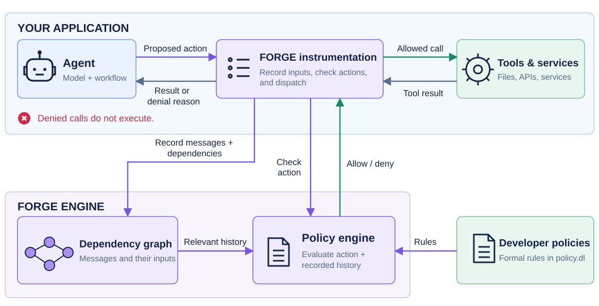

# Formal Policy Enforcement for Agentic Systems

FORGE enforces Datalog policies at runtime in agentic systems. It constructs causal event graphs of messages, tool calls, tool results, and their dependencies. Before a candidate action executes, FORGE evaluates the policy against the current system state and event history, then permits or blocks the action.

This repository contains the experiment code and results for the [FORGE paper](https://arxiv.org/abs/2602.16708). [SASY](https://github.com/sasy-labs/sasy) is the released implementation of FORGE.



## Run evaluations

Follow one of the setup methods below. The Nix setup is recommended when Nix is available.

### Setup

Requirements: Python 3, Git, [uv](https://docs.astral.sh/uv/), and the [native build prerequisites](https://docs.sasy.ai/building/): Rust, Soufflé, and a C++ toolchain.

```bash
python3 scripts/setup_evaluation.py
```

### Setup (Nix)

Requirements: Python 3, Git, and [Nix](https://nixos.org/download/). The development shell provides uv and the native toolchain.

```bash
python3 scripts/setup_evaluation.py --nix
```

Run subsequent evaluation commands from the development shell:

```bash
nix --extra-experimental-features 'nix-command flakes' develop ./sasy
```

### Run

Configure provider credentials in the environment, `.env`, or `.env-credentials`: Azure uses `AZURE_API_KEY`, `AZURE_API_BASE`, and `AZURE_API_VERSION`; Vertex uses `VERTEXAI_PROJECT` and application-default credentials (`gcloud auth application-default login`). MALADE also needs OpenFDA credentials and [Qdrant](experiments/malade/#run).

Run the four case studies:

```bash
uv run python scripts/evaluation/run_benchmark.py --targets paper --user-model opus
```

Select `--targets malade`, `infoflow`, `tau2`, or `agentdojo` for one case study. The runner starts a local engine and saves each run under `results/<timestamp>/`. The [evaluation guide](scripts/evaluation/) covers resuming and latency measurements. Policy translation uses a [separate harness](experiments/translation/).

## Summarize results

Generate tables from a saved case study:

```bash
uv run python scripts/evaluation/summarize_{case_study}.py results/{case_study}/manifest.json
```

Replace `{case_study}` with `malade`, `tau2`, `infoflow`, or `agentdojo`. Runtime and cost are means per trial (per scenario for information flow).

## Experiments

| Experiment | Code and instructions | Saved results |
|---|---|---|
| MALADE: approval before FDA access | [MALADE](experiments/malade/) | `results/malade/` |
| tau2: airline and retail policies | [tau2](experiments/tau2/) | `results/tau2/` |
| Information flow: confidentiality and prompt injection | [Information flow](experiments/information-flow/) | `results/infoflow/` |
| AgentDojo: prompt injection defenses | [AgentDojo](experiments/agentdojo/) | `results/agentdojo/` |
| Policy translation | [Translation](experiments/translation/) | `results/translation/` |
| Authorization latency and throughput | [Evaluation scripts](scripts/evaluation/) | `results/latency/` |

## Cite

If you find this work useful in your own research, please consider citing the following:

```bibtex
@misc{palumbo2026formalpolicyenforcementrealworld,
  title={Formal Policy Enforcement for Agentic Systems},
  author={Nils Palumbo and Sarthak Choudhary and Jihye Choi and Guy Amir and Prasad Chalasani and Isil Dillig and Somesh Jha},
  year={2026},
  eprint={2602.16708},
  archivePrefix={arXiv},
  primaryClass={cs.CR},
  url={https://arxiv.org/abs/2602.16708},
}
```
